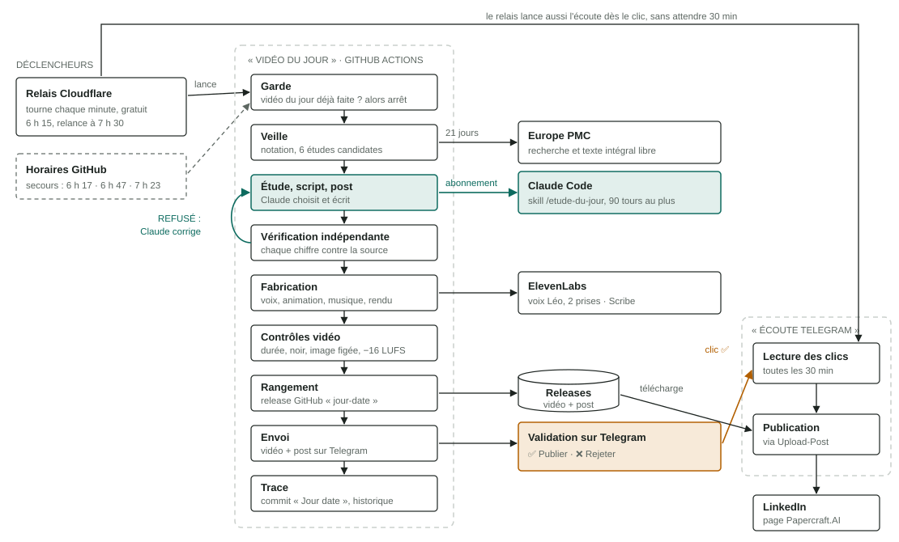
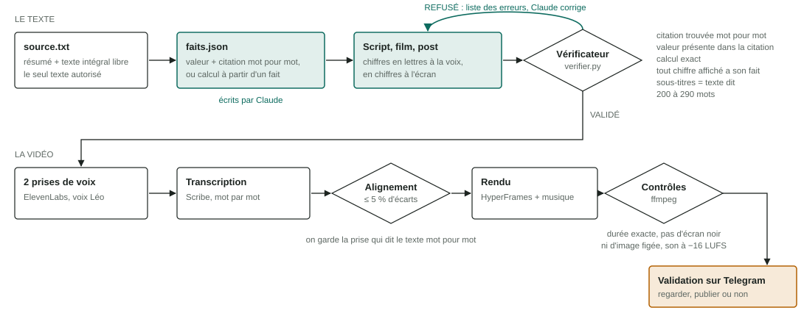
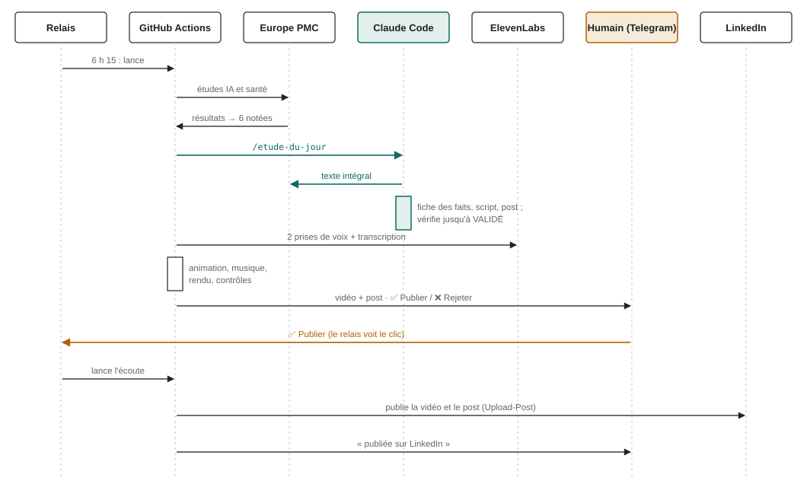

# Papercraft.AI · une étude IA & santé par jour

Chaque matin, GitHub Actions :
1. cherche les études récentes (Europe PMC) — `pipeline/veille.py` ;
2. Claude choisit l'étude, écrit la fiche des faits, le script, l'animation et le post — skill `.claude/skills/etude-du-jour` ;
3. un second agent, qui n'a rien écrit, relit le film contre la source (sens des résultats, causalité, population, limite) et
   corrige le strict nécessaire — skill `.claude/skills/relecture`, filet de sécurité `pipeline/relecture.py` ;
4. `pipeline/verifier.py` refuse tout chiffre absent de la source ;
5. `pipeline/fabriquer.py` fait la voix (ElevenLabs, Brick : `serie/audio/voix.json`), l'animation (HyperFrames), la musique, le rendu
   et les contrôles, dont le contrôle d'images (`serie/moteur/controle_images.mjs` : écrans vides, cadres sous-remplis) ;
6. `pipeline/publication.py envoyer` envoie la vidéo sur Telegram avec Publier / Rejeter, le verdict de la relecture et le bilan
   du contrôle d'images ;
7. toutes les 30 min, `publication.py ecouter` lit les clics et publie sur la page LinkedIn Papercraft.AI (API officielle, Upload-Post en secours).

## Le fonctionnement en schémas

*Vert : Claude. Orange : action humaine. Pointillés : secours.*

**Architecture.** Deux workflows GitHub Actions, un relais Cloudflare qui les lance à l'heure (le
planificateur de GitHub prend parfois des heures de retard), et cinq services externes. Une garde
empêche toute vidéo en double ; une alerte Telegram signale toute étape en échec.

**La chaîne de preuve.** Claude écrit, mais ne peut rien inventer : chaque chiffre de la vidéo vient
de `faits.json`, chaque fait cite `source.txt` mot pour mot, et `pipeline/verifier.py` refuse tout
écart. La voix est ensuite comparée à sa transcription, puis la vidéo passe ses propres contrôles
avant la validation humaine.

**Une journée, dans l'ordre.** Tout est automatique jusqu'à la vidéo sur Telegram ; rien n'est
publié sans le clic « Publier ».

Secrets (Settings → Secrets and variables → Actions) : `CLAUDE_CODE_OAUTH_TOKEN`, `ELEVENLABS_API_KEY`,
`TELEGRAM_BOT_TOKEN`, `TELEGRAM_CHAT_ID`, `UPLOAD_POST_API_KEY`.
Variables facultatives : `PUBLICATION_AUTO` = `oui` pour publier sans validation ; `RELECTURE` = `non` pour couper la relecture
indépendante.

Règles de contenu : `serie/REGLES-CONTENU.md`. Format de l'animation : `serie/FILM-SCHEMA.md`.
Charte visuelle : `serie/frame.md` (DA v4 « plein cadre », cinq accroches qui tournent, éditions de couleur : `serie/moteur/editions.json`) ; ses planches jouées en animation : `serie/reference/planches.html`.
Méthode et moteur dérivés de `motion-design-claude-code` (MIT, Colin Blain). Effets sonores : Pixabay Content License.
